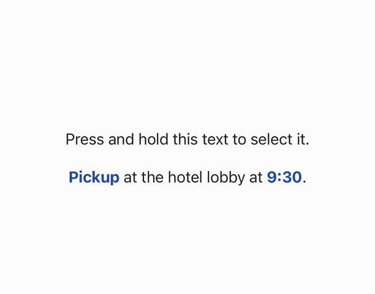

# expo-text-selectable

Read-only text with native selection handles on iOS. Inline spans share a single selection range, so a copy operation can cross formatting boundaries. Android uses React Native's selectable text.



## Installation

```sh
npm install expo-text-selectable
```

Rebuild your Expo iOS app after installing the package. The custom native view requires a development or production build. An app without the native view falls back to React Native Text.

## Usage

```tsx
import { SelectableText } from "expo-text-selectable";

<SelectableText style={{ fontSize: 14, lineHeight: 20 }}>
  <SelectableText.Span style={{ fontWeight: "600" }}>Pickup</SelectableText.Span>
  {": Meet at the hotel lobby at 09:30."}
</SelectableText>;
```

Plain strings, numbers, fragments, and nested spans are supported. Inline styling covers color, font family, font size, font weight, and letter spacing. The root also supports line height, alignment, writing direction, line limits, and font scaling. Custom fonts are loaded by the host application.

On iOS, tap outside the text to clear the selection.

The initial compatibility target is Expo SDK 58 and React Native 0.88. Arbitrary React elements inside the text use the React Native fallback.

## License

MIT
